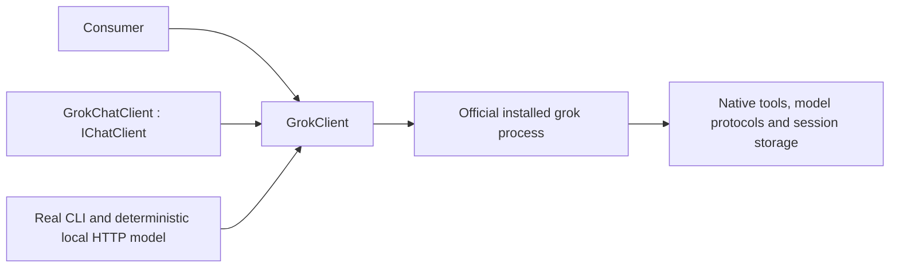

# Architecture

ManagedCode.GrokSharpSDK is a .NET 10 client for the official Grok Build CLI. The core executes native streaming-json turns, resumes native sessions and owns sign-in lifetimes. Extensions.AI implements Microsoft.Extensions.AI.IChatClient and DI registration.

## Boundaries

- Core: configuration, shell-free executable resolution, native event parsing, cancellation, session identity and sign-in.
- Extensions.AI: text/history mapping, response/usage mapping, token streaming and DI. Native tools execute in Grok; caller-supplied MEAI function tools are rejected.
- Tests: real pinned CLI, deterministic test-owned model HTTP endpoint and isolated profiles. Hosted model accounts are not required.
- submodules/xai-grok-build: pinned upstream protocol reference, not a runtime dependency.

The SDK does not implement model/provider APIs, OAuth token exchange or another conversation store.
